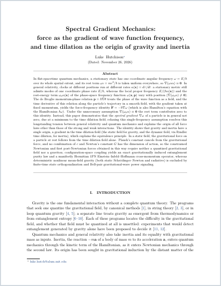
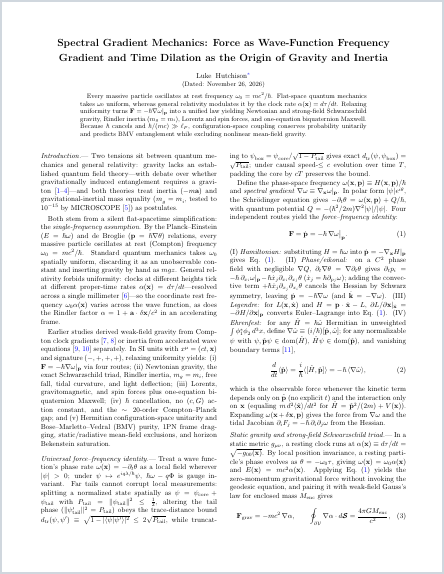
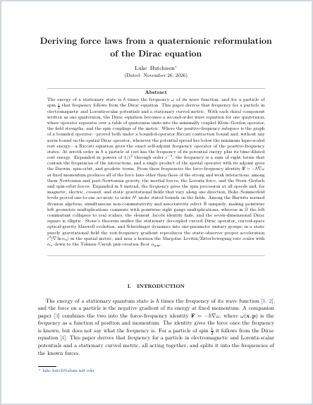
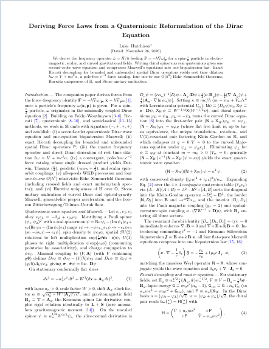

# Spectral Gradient Mechanics (SGM)

**Two Companion Papers, Symbolic/Numerical Verification Suite, and Lean 4 Formalization**

## Overview

In quantum mechanics, every particle behaves as a wave oscillating at a frequency set by its energy ($`E = \hbar\omega`$), starting from its rest-mass frequency $`\omega_0 = mc^2/\hbar`$. In empty flat space, that frequency is uniform everywhere. Once fields or gravity are present, however, the local oscillation frequency $`\omega(\mathbf{x})`$ varies from place to place—potentials shift the particle's energy, and gravitational time dilation $`\alpha(\mathbf{x}) = \sqrt{-g_{00}}`$ makes clocks (and matter waves) tick more slowly deeper in a gravitational well.

**Spectral Gradient Mechanics (SGM)** shows that forces across classical and quantum physics share a single universal law, where force is linearly proportional to the **spectral gradient**, the gradient in the wave function's frequency:

$$
\mathbf{F} = -\hbar\,\nabla\omega\big|_{\mathbf{p}}
$$

A particle is driven toward lower oscillation frequency at a rate set by the spatial gradient of its wave function's frequency field (evaluated at fixed momentum).

**The quaternionic wave equation** is a reformulation of the relativistic Dirac wave equation that encodes each two-component spin $`\tfrac{1}{2}`$ chiral spinor as a single real quaternion ($`\mathbb{H}`$) and combines the chiral pair into one second-order wave equation on general curved stationary spacetime. Because left quaternion multiplication represents spatial rotations and spin while right multiplication by $`e_3`$ represents quantum phase (the imaginary unit $`i`$), the wave operator separates cleanly across a $`4\times 4`$ table of quaternion units into the Klein–Gordon operator, the electric and gravitational field strengths, and the magnetic, gravitomagnetic, and spatial-curvature spin couplings. Decoupling its positive- and negative-frequency branches yields the exact frequency operator $`\hat{\omega}`$ that feeds directly into $`\mathbf{F} = -\hbar\nabla\omega|_{\mathbf{p}}`$ to derive every classical and relativistic force law and spin precession outside the strong and weak interactions.

### Key Implications

- **Gravity is a consequence of time dilation, not the reverse.** Gravitational time dilation scales a resting particle's oscillation rate to $`\omega(\mathbf{x}) = (mc^2/\hbar)\,\alpha(\mathbf{x})`$. Taking its spatial gradient immediately gives $`\mathbf{F} = -mc^2\nabla\alpha`$—recovering Newtonian gravity in the weak field and the exact Schwarzschild force in the strong field—directly from clock-rate gradients, without assuming the geodesic equation.
- **Inertia and the equivalence principle share the same origin.** In an accelerating frame, relativistic simultaneity creates a Rindler time-dilation gradient across a particle's wave function. The same force-frequency law yields the inertial reaction $`-m\mathbf{a}`$ with the identical rest-frequency prefactor $`\omega_0 = mc^2/\hbar`$, guaranteeing that gravitational mass equals inertial mass ($`m_g = m_i`$).
- **Gravity requires no particle-scale graviton.** Planck's constant $`\hbar`$ cancels identically out of the gravitational force, $`\mathbf{F} = -\hbar\nabla\big((mc^2/\hbar)\alpha\big) = -mc^2\nabla\alpha`$, and dimensional analysis proves that no combination of $`G`$ and $`c`$ alone has the dimensions of action (`prop:no_grav_action`). General relativity treats spacetime and time dilation as a smooth continuous manifold, while matter quantization acts at the **particle (Compton) scale** $`\hbar/(mc)`$—roughly **20 orders of magnitude** larger than the Planck length $`\ell_P = \sqrt{\hbar G/c^3}`$. Even if time dilation possesses a discrete microstructure at the Planck scale, it appears smooth and continuous in every particle-scale experiment.
- **Superposed masses preserve probability and entangle unitarily.** If an atom is in a spatial superposition ("in two places at once"), its static gravitational constraint assigns the time-dilation profile branch-by-branch on the joint matter wave function rather than pulling from an averaged midpoint. The resulting pair Hamiltonian is strictly Hermitian—keeping total probability conserved at $`100\%`$ ($`\langle\Psi|\Psi\rangle = 1`$)—and produces gravitationally induced entanglement (BMV purity) without invoking a graviton. By contrast, deterministic nonlinear mean-field gravity (Schrödinger–Newton or radiative mean-field sourcing) breaks linear unitarity and allows superluminal signaling.
- **One unified relativistic & electromagnetic algebra.** Among the four normed division algebras, associativity plus spin non-commutativity uniquely selects the quaternions $`\mathbb{H}`$; the same first-order quaternionic operator governs both the massless Weyl spinor equation and all four of Maxwell's equations compressed into a single biquaternion equation.

### The Two Companion Papers

Each companion paper is provided both as a **full manuscript** (complete derivations, proofs, appendices, and supplements) and as a **4-page *Physical Review Letters* (PRL) short summary**. All LaTeX sources and the shared bibliography live in [`papers/`](papers/), and compiled PDFs with Page-1 previews live in [`pdf/`](pdf/).

#### Paper I — *Spectral Gradient Mechanics: force as the gradient of wave function frequency, and time dilation as the origin of gravity and inertia*

Derives $`\mathbf{F} = -\hbar\nabla\omega|_{\mathbf{p}}`$ via four independent routes (Hamiltonian, eikonal/convective, Legendre/dispersion, and Ehrenfest); applies it to electromagnetism, inertia, light deflection, and strong-field gravity; shows that Maxwell's four equations collapse into a single biquaternion equation; proves the absence of a gravitational action quantum and quantifies the Compton-to-Planck scale gap; and contrasts unitary configuration-space gravitational entanglement and post-Newtonian frame dragging against nonlinear mean-field signaling exclusions.

<table width="60%">
  <thead>
    <tr>
      <th width="50%" align="center">Full Paper (84 pp.)</th>
      <th width="50%" align="center">4-Page PRL Summary</th>
    </tr>
  </thead>
  <tbody>
    <tr>
      <td width="50%" align="center"><a href="pdf/sgm.pdf"></a></td>
      <td width="50%" align="center"><a href="pdf/sgm_short.pdf"></a></td>
    </tr>
    <tr>
      <td width="50%" align="center"><a href="pdf/sgm.pdf"><strong>PDF</strong></a> · <a href="papers/sgm.tex">LaTeX</a><br><code>sgm.pdf</code></td>
      <td width="50%" align="center"><a href="pdf/sgm_short.pdf"><strong>PDF</strong></a> · <a href="papers/sgm_short.tex">LaTeX</a><br><code>sgm_short.pdf</code></td>
    </tr>
  </tbody>
</table>

#### Paper II — *Deriving force laws from a quaternionic reformulation of the Dirac equation*

Builds the quaternionic Weyl/Dirac wave equation on general curved stationary spacetime slices; proves exact positive/negative-frequency decoupling for both bounded and unbounded momentum operators; derives a convergent, pole-free $`c^{-2}`$ catalog of all relativistic forces and spin precessions; proves all-speeds WKB quasimode bounds and four **one-to-one** $`O(\hbar^2)`$ relativistic Bohr–Sommerfeld quantization theorems; and establishes the algebraic and unitary constraints (selection of $`\mathbb{H}`$ over the octonions $`\mathbb{O}`$, single-equation biquaternion Maxwell & curved optical-gravity Maxwell unification, and horizon Zitterbewegung limits).

<table width="60%">
  <thead>
    <tr>
      <th width="50%" align="center">Full Paper (94 pp.)</th>
      <th width="50%" align="center">4-Page PRL Summary</th>
    </tr>
  </thead>
  <tbody>
    <tr>
      <td width="50%" align="center"><a href="pdf/sgm_wavefn.pdf"></a></td>
      <td width="50%" align="center"><a href="pdf/sgm_wavefn_short.pdf"></a></td>
    </tr>
    <tr>
      <td width="50%" align="center"><a href="pdf/sgm_wavefn.pdf"><strong>PDF</strong></a> · <a href="papers/sgm_wavefn.tex">LaTeX</a><br><code>sgm_wavefn.pdf</code></td>
      <td width="50%" align="center"><a href="pdf/sgm_wavefn_short.pdf"><strong>PDF</strong></a> · <a href="papers/sgm_wavefn_short.tex">LaTeX</a><br><code>sgm_wavefn_short.pdf</code></td>
    </tr>
  </tbody>
</table>

---

## Key Mathematical & Algorithmic Findings

1. **Universal Force–Frequency Identity & Wave-Function Truncation Control (`sgm.tex` Secs. 2–3):**
   - Four independent derivations—Hamilton's equations, $`C^2`$ eikonal convective cancellation, the Legendre dispersion bridge, and Ehrenfest's commutator law (with explicit domain and symmetry hypotheses)—converge on $`\mathbf{F} = -\hbar\nabla\omega|_{\mathbf{p}}`$. In static gravity, $`\hbar`$ drops out of the force $`-mc^2\nabla\alpha`$ while remaining in interferometric phase shifts.
   - Truncating a normalized wave function to a finite region whose far tail carries probability $`P_\text{tail}`$ changes the state by exact pure-state trace distance $`d_\text{tr}(\psi,\psi_\text{box}) = \sqrt{P_\text{tail}}`$, bounding every measurement probability shift.
   - In strong-field Schwarzschild spacetime (both areal and isotropic coordinates), the coordinate force, local proper weight, and force-at-infinity obey $`\mathbf{F}_\text{SGM} = \mathbf{F}_\text{prop} = \alpha^{-1}\mathbf{F}_\infty`$, reconciling with the general non-diagonal static metric norm $`m a_\text{prop} = \alpha^{-1}\sqrt{h^{jk}F_j F_k}`$ and the exact exterior Komar–Gauss flux $`4\pi GM/c^2`$.

2. **Constrained Configuration-Space Gravity, Scale Separation & Mean-Field Exclusions (`sgm.tex` Secs. 7.2–7.4 & Supp. S8):**
   - **No gravitational action quantum (`prop:no_grav_action`) & Compton-to-Planck scale gap (`eq:compton_planck_ratio`):** The $`3\times 3`$ dimensional matrix for $`(G, c, \hbar)`$ has $`\det = 2 \neq 0`$, proving no product of powers of $`G`$ and $`c`$ yields action, while the Planck force $`c^4/G`$ is independent of $`\hbar`$. Proton and electron Compton wavelengths sit $`m_P/m_p \approx 1.30\times 10^{19}`$ and $`m_P/m_e \approx 2.39\times 10^{22}`$ times above $`\ell_P`$—roughly $`20`$ orders of magnitude separating particle quantization from any putative Planck-scale structure of time dilation.
   - **BMV entanglement purity vs. Schrödinger–Newton orthogonalization (`prop:config_space_gravity`):** Correct $`\tfrac{1}{2}`$ pair counting gives the Hermitian configuration-space operator $`H_\text{grav,pair}`$ on $`\mathcal{H}_\text{mat}`$, conserving total probability unitarily and yielding exact reduced-state purity $`\mathrm{tr}(\hat{\rho}_1^2) = 1 - \tfrac{1}{2}\sin^2(\Delta\theta_\text{grav}/2)`$. By contrast, two-site Schrödinger–Newton mean-field gravity drives states with initial overlap $`\sqrt{3}/2`$ to exact orthogonality in finite time $`t_*^\text{SN} = \pi\hbar/(U_\text{self} - U_\text{cross})`$, breaking unitarity and enabling Gisin collapse signaling.
   - **Manifestly Hermitian 1PN moving-source coupling (`prop:eih_1pn`):** Eliminating the constrained gravitomagnetic shift at first post-Newtonian order yields a manifestly Hermitian 3D tensor-sandwich operator $`\tfrac{1}{2}\big(\hat{p}_{i,a}\mathcal{W}_{ij}^{ab}\hat{p}_{j,b} + \hat{p}_{j,b}\mathcal{W}_{ij}^{ab}\hat{p}_{i,a}\big)`$ directly on $`\mathcal{H}_\text{mat}`$ with positive Lense–Thirring frame dragging.
   - **Radiative mean-field exclusion (`prop:rad_meanfield_signaling`):** Coupling matter to deterministic nonlinear radiative mean fields $`h_{ij}^\text{TT}[\langle\hat{T}_{\mu\nu}\rangle]`$ produces both finite-time orthogonalization (even at identical static mass densities) and a superluminal Bell gravitational-wave power bias $`\Delta P_\text{GW} = G \mathcal{Q}_0^2 \Omega_\text{quad}^6 / (10 c^5)`$.
   - **Horizon Bekenstein saturation (`eq:bek_bh_sat`, `rem:reach`):** Along a Schwarzschild sphere of areal radius $`r > R_s`$, the matter-side Bekenstein ratio obeys $`2\pi r(Mc^2)/(\hbar c) = (A(r)/4\ell_P^2)(1-\alpha(r)^2) \to A(R_s)/(4\ell_P^2)`$ as $`\alpha(r)\to 0`$, cleanly separating classical exterior field laws from quantum-gravitational boundary completeness.

3. **Quaternionic Selection, Single-Equation Maxwell Formulation & Octonionic Obstructions (`sgm.tex` Sec. 4.6; `sgm_wavefn.tex` Secs. 3 & 7.6, App. A.2 & A.8):**
   - Sequential closure of left multiplications into a single algebra element ($`\forall a,b\,\exists c,\, L_a\circ L_b = L_c`$) holds if and only if the algebra is associative, uniquely selecting the quaternions $`\mathbb{H}`$ among the four Hurwitz division algebras $`\{\mathbb{R},\mathbb{C},\mathbb{H},\mathbb{O}\}`$ once spin non-commutativity is required.
   - Over $`\mathbb{H}`$, left spin rotations commute pointwise with right $`U(1)`$ phases ($`[L_a, R_b]=0`$), while spatially varying potentials generate $`\mathbf{E}`$ and $`\mathbf{B}`$ via $`[\partial_\mu, R_{fe_3}]\psi = (\partial_\mu f)\psi e_3`$. The 16 two-sided maps $`e_\mu\psi e_\nu`$ form a basis of $`\mathrm{End}_\mathbb{R}(\mathbb{H})`$, and the $`4\times 4`$ wave operator table decomposes cleanly into Klein–Gordon (diagonal), electric/gravitational (border), and magnetic/curvature (interior) blocks.
   - **All four of Maxwell's equations as a single quaternion (biquaternion) equation (`eq:maxwell_biquaternion`):** The Jacobi identity of the covariant derivatives automatically yields the two homogeneous Maxwell equations ($`\nabla\cdot\mathbf{B}=0`$, $`\nabla\times\mathbf{E}+\partial_t\mathbf{B}=\mathbf{0}`$). Introducing a commuting imaginary unit $`\mathsf{i}`$ and forming the Riemann–Silberstein biquaternion $`\mathcal{F} = \mathbf{E}\cdot\mathbf{e} + \mathsf{i}\,c\,\mathbf{B}\cdot\mathbf{e}`$ collapses all four Maxwell equations with sources into the single equation $`\big(\mathbf{e}\cdot\nabla - (\mathsf{i}/c)\,\partial_t\big)\mathcal{F} = -\rho_q/\varepsilon_0 + \mathsf{i}\,\mu_0 c\,\mathbf{J}_q\cdot\mathbf{e}`$—using the exact same first-order operator as the massless quaternionic Weyl equation (with $`\mathsf{i}`$ in place of right-multiplication $`i`$), and yielding charge conservation $`\partial_t\rho_q + \nabla\cdot\mathbf{J}_q = 0`$ directly as its consistency condition. In curved static metrics, optical-gravity Maxwell evolution factors into a self-adjoint congruence $`\hat{H}_\text{Max}^{(n)} = M_\text{opt} C_0 M_\text{opt}`$ on the weighted transverse subspace $`\nabla\cdot(\sqrt{n_\text{opt}}\tilde{\mathbf{F}})=0`$, generating a Stone unitary evolution group.
   - Over the Fano octonions $`\mathbb{O}`$: (i) the left-action commutant collapses to $`\mathrm{End}_{\mathbb{O}_L}(\mathbb{O}) = \mathbb{R}\cdot I_8`$, excluding any commuting complex phase operator $`J^2=-I_8`$; (ii) element Jacobi fails ($`[e_1,[e_2,e_4]]+\text{cyc}=-12e_7`$) and $`[L_a,L_b]=L_{[a,b]}-2[L_a,R_b]\neq L_d`$ obstructs single-field-strength curvature reduction; and (iii) the 7D Dirac operator satisfies $`L_{e_a}L_{e_b}+L_{e_b}L_{e_a}=-2\delta_{ab}I_8`$, yielding an elliptic principal symbol ($`\mathcal{D}_7^2 = -\Delta_7 I_8`$).

4. **Exact Riccati Decoupling, Unbounded $`\mathsf{P}`$ Lyapunov Gap & Convergent $`c^{-2}`$ Expansion (`sgm_wavefn.tex` Secs. 4–5 & App. A.8):**
   - **Bounded contraction ($`\epsilon < 1`$):** The operator Riccati map $`\mathcal{F}(\mathsf{R})`$ is an $`\epsilon`$-contraction on the closed unit ball $`\|\mathsf{R}\|\le 1`$ in any complete normed algebra, yielding a unique decoupling operator ($`\|\mathsf{R}\|\le\epsilon`$) and a unitary Eriksen transformation $`\mathsf{U}`$ satisfying $`\mathsf{U}\mathsf{H}\mathsf{U}^\dagger = \mathrm{diag}(\hat{h},\hat{h}_-)`$.
   - **Unbounded $`\mathsf{P}`$ Lyapunov theorem:** For **arbitrary unbounded** symmetric $`\mathsf{P}`$, off-diagonal terms cancel identically in $`\mathrm{Re}\langle\beta\Psi,(\mathsf{H}-V_0)\Psi\rangle = \langle u,Au\rangle + \langle w,(-D)w\rangle \ge \delta\|\Psi\|^2`$, establishing a uniform spectral gap $`\|(\mathsf{H}-V_0)\Psi\|\ge\delta\|\Psi\|`$ and strict positive-energy graph contraction $`\|w\| < \|u\|`$ ($`\|\mathsf{R}u\| < \|u\|`$) independent of $`\|\mathsf{P}\|`$.
   - **Pole-free $`\lambda = 1/(2mc^2)`$ expansion:** Rescaling $`\mathsf{Q}=c\mathsf{R}`$ produces a $`(1/2)`$-contraction on $`\|\mathsf{Q}\|\le\|\mathsf{P}\|/m`$, binomial convergence $`\|\mathsf{W}(\lambda)-1\|\le 1/2`$, Cauchy truncation error $`2\mathcal{K}(|\lambda|/\lambda_1)^{N+1}`$, exact cancellation of $`\mathsf{R}_1`$, the dressed spatial operator catalog, and the PPN geodetic coefficient $`\gamma_\text{PPN}+\tfrac{1}{2}`$.

5. **All-Speeds WKB & Four One-to-One $`O(\hbar^2)`$ Relativistic Bohr–Sommerfeld Theorems (`sgm_wavefn.tex` Sec. 6 & App. B):**
   - The static WKB residual terminates identically at $`O(\hbar^2)`$, giving an exact quasimode spectral distance bound (`eq:quasimode`).
   - In static curved metrics (`lem:grav_spin`), $`qB`$ and $`W'`$ cancel identically in $`\Omega_z + \dot{\phi}_\mathbf{n}`$, splitting the spin precession angle $`\Theta_\text{spin}`$ into a Berry solid angle plus a Rammal–Wilkinson term ($`\Theta_\text{spin}=-2\pi`$ whenever $`\alpha_n`$ and $`V`$ are constant).
   - Combining Olver's uniform Airy matching, Prüfer/Sturm comparison (Lemma 5), quadratic monotonicity completion (Lemma 8), continuous integer-label transfer without global monotonicity (Lemma 6(b)), and IVT action-to-energy transfer (Lemma 1) establishes **one-to-one** $`O(\hbar^2)`$ spectral approximation for magnetic (Thm. 1), electric (Thm. 2), static gravitational with exact $`\nu^{\pm 1/2}=(\alpha_n/W)^{\pm 1/2}`$ Weyl-sequence rescaling (Thm. 4), and **crossed-field** blocks (Thm. 3(b), via boost congruence, Hellmann–Feynman strict negativity $`f_n'(E_\text{d})<0`$ at every crossing zero, and an at-most-one-zero theorem; plus exact zero-remainder uniform and shape-invariant $`\tanh`$ checks in Thm. 3(c)–(d)).

---

## Symbolic & Numerical Verification Suite (`verification/`)

Every displayed equation, numerical estimate, and spectral theorem across both manuscripts is independently verified by standalone Python (SymPy, NumPy, SciPy) scripts and a derivation-DAG auditor in `verification/`:

| Script | Size | Coverage & Method |
| :--- | ---: | :--- |
| `verification/sgm_check.py` | 6,501 lines / 203 blocks | Walks `sgm.tex` in exact manuscript order (**`1,015/1,015`** checks passing): all four force routes, box-truncation trace distance, strong-field Schwarzschild triad & Komar–Gauss flux, CODATA/experimental benchmarks (COW neutron interferometry, Cs atom interferometry, Gravity Probe B, Pound–Rebka, Hafele–Keating), Compton-to-Planck scale ratios (`eq:compton_planck_ratio`), pair counting, BMV purity, two-site SN orthogonalization, 1PN EIH tensor sandwich, radiative quadrupole GW-power bias, Bekenstein–BH saturation, `tab:notation` SI units, and Supplements S1–S8. |
| `verification/sgm_wavefn_check.py` | 11,323 lines / 402 blocks | Walks `sgm_wavefn.tex` in exact manuscript order (**`1,680/1,680`** checks passing): quaternionic Weyl/Dirac algebra, covariant derivatives, Maxwell biquaternions, Riccati contraction & Eriksen rotation, unbounded $`\mathsf{P}`$ Lyapunov coercivity, $`c^{-2}`$ expansion and dressed spatial operators (Darwin, Thomas, geodetic, shift-strain Moyal calculus), all-speeds WKB precession, Bohr–Sommerfeld rules, crossed-field boost/Hellmann–Feynman & Rosen–Morse II termination edge-case checks, Fano octonions (commutant collapse, Jacobi failure, 7D elliptic symbol), curved optical-gravity Maxwell energy conservation, hyperbolic bimodule flow, and horizon Zitterbewegung/Tolman–Unruh limits. |
| `verification/worked_example.py` | 296 lines | Numerical spectral testbench for Theorems 1, 2, and 4 (`thm:levels_B`, `thm:levels_V`, `thm:levels_grav`): diagonalizes the reduced operator $`\mathsf{K}(E)`$ and the $`2\times 2`$ curved-metric Dirac block on periodic Fourier grids across inhomogeneous magnetic, electric, and curved static gravitational profiles, confirming box/grid/quadrature convergence, $`O(\hbar^2)`$ accuracy of the full spin-angle rule vs. $`O(\hbar)`$ of the root rule, and the exact one-to-one level count on $`J = [1.2, 2.1]`$. |
| `verification/dag_check.py` | 342 lines | Enforces manuscript-order alignment between each `.tex` file and its check script, verifies that every `Derived from` source label is defined strictly earlier (acyclic derivation DAG), and resolves all `\label`/`\ref` chains (`papers/sgm.tex`: 232 labels, 1,006 refs; `papers/sgm_wavefn.tex`: 287 labels, 792 refs; `papers/sgm_short.tex`: 16 labels, 17 refs; `papers/sgm_wavefn_short.tex`: 21 labels, 15 refs). |

### Mutation Testing & Negative Controls
Each block in `sgm_check.py` and `sgm_wavefn_check.py` pairs exact symbolic identities (`symcheck` via SymPy), numerical comparisons to explicit relative tolerances (`check` via NumPy/SciPy), and structural assertions (`boolcheck`) with at least one mandatory **negative control** (`mutant` / `numutant`). Each mutant deliberately corrupts a sign, factor, or operator ordering and re-runs the test; if the check fails to catch the corruption, the block fails.

---

## Lean 4 Formalization (`lean/`)

### Compilation Status

The entire Lean 4 formalization compiles cleanly with zero errors, zero linter warnings, and zero `sorry`s.

| Metric | Verified Result |
| :--- | :--- |
| Toolchain | `leanprover/lean4:v4.36.0` + Mathlib4 (`fc4f59e5`) |
| Build command | `cd lean && lake build` (`-Dlinter.unusedVariables=true` enabled in `lakefile.toml`) |
| Build status | **PASS** — `Build completed successfully (7136 jobs)`, 0 errors, 0 linter warnings |
| Modules | 16 library modules (+ root `lean/SGM.lean`), 4,690 lines |
| Proved declarations | **147** public `theorem` / `lemma` proofs (+ 1 private helper) |
| `sorry` / `admit` / custom `axiom` | **0** |
| Axiom footprint (`#print axioms` / `collectAxioms`) | Audited across all `521` `SGM.*` kernel theorem declarations: `0` unexpected axioms (`propext`, `Classical.choice`, `Quot.sound` only) |

### What the Axiom Audit Means
Every one of the 147 public theorems and lemmas across the 16 modules (+ root `lean/SGM.lean`, 4,690 lines) is verified directly by Lean's kernel with **no `sorry` placeholders, no `admit`s, and no custom `axiom` declarations**. Auditing all `SGM.*` declarations with `Lean.collectAxioms` / `#print axioms` confirms that every proof relies exclusively on Lean's three standard foundational axioms:

- `propext` (propositional extensionality),
- `Classical.choice` (classical choice, used across Mathlib's real analysis and inner-product spaces), and
- `Quot.sound` (quotient soundness).

External classical-analysis inputs such as Olver's uniform Airy matching (Proposition 5 / Lemma 7 of `sgm_wavefn.tex`) are never asserted as opaque global axioms. Instead, they are supplied explicitly as typed hypothesis structures (`MonotoneScalarMatchingData` in `SGM/Semiclassical/LevelTheorems.lean`), keeping every mathematical assumption transparent in each theorem's type signature and end-to-end checked by Lean.

### The 4 Phases of the Lean Code Structure (`lean/SGM/`)

The formalization is structured into four dependency-ordered phases, aggregated by `lean/SGM.lean`:

```text
Phase 1: Basic & Algebra          (SGM/Basic/*, SGM/Algebra/*)
   │
   ▼
Phase 2: Differential & Gravity   (SGM/Differential/*)
   │
   ▼
Phase 3: Operators & Decoupling   (SGM/Operators/*)
   │
   ▼
Phase 4: Semiclassical & Levels   (SGM/Semiclassical/*)
```

#### Phase 1 — Foundations, Dimensional Analysis & Quaternionic/Octonionic Algebra
| Module | Lines | Core Theorems Formalized |
| :--- | ---: | :--- |
| `SGM/Basic/Dimensions.lean` | 138 | `no_grav_action_constant`, `dimMatrix_det` ($`\det=2`$), `dimMatrix_mul_inv`, Planck scale uniqueness, `planck_force_cancel_hbar`, `hbar_cancels_grav_force`, `radians_per_crossing_scale_invariant` |
| `SGM/Basic/TraceDistance.lean` | 339 | `tail_phase_trace_distance`, `box_truncation_trace_distance` ($`d_\text{tr} = \sqrt{P_\text{tail}}`$), `pure_state_measurement_prob_diff_le_trace_distance` (outcome probability bound for arbitrary symmetric effects $`0 \le P \le I`$) |
| `SGM/Basic/PhaseSpace.lean` | 101 | `route_I_force_frequency`, `route_II_convective_cancellation`, `legendre_bridge`, `isotropic_refractive_index_expansion`, `magnetic_lorentz_zero_work`, `spectral_third_law` |
| `SGM/Algebra/QuaternionSpinor.lean` | 179 | `e1_sq`..`e1_mul_e3`, `vector_quaternion_product`, `quatToSpinor_spinorToQuat`, `sigma1_eq_quat`..`neg_i_sigma3_eq_left_e3`, `normSq_spinorToQuat`, `spinQuat_matches_pauli`, `spinQuat_right_phase_invariant`, `spinQuat_left_rotor` |
| `SGM/Algebra/BimoduleOctonions.lean` | 482 | `quat_bimodule_commutator`, `linearMap_jacobi`, `single_elem_closure_iff_assoc`, Fano `Oct` (`normSq_mul`, `left_alternative`, `right_alternative`, `assoc_e1_e4_e2`, `oct_not_single_elem_closed`, `alternative_left_commutator`, `oct_curvature_not_single_left`, `commutant_collapse`, `no_commuting_complex_structure`, `oct_element_jacobi_failure`, `oct_pure_clifford_anticomm`, `oct_clifford_anticomm`, `d7_real_symbol_elliptic`), `e3_sandwich_involution`, `bimoduleFlow_ode` (full 4-component `.re/.imI/.imJ/.imK` ODE + initial value), `bimoduleFlow_norm_blowup` |
| `SGM/Algebra/WeylUniqueness.lean` | 124 | `twoSidedOp_linearIndependent` (16-element basis), `scalar_op_uniqueness`, `majoranaConj` ($`\psi \mapsto \psi e_2`$), `majoranaConj_sq`, `majoranaConj_anticomm_e3`, `majoranaConj_comm_left`, `majoranaConj_normSq` |

#### Phase 2 — Covariant Derivations, Maxwell & Curved-Spacetime Gravity
| Module | Lines | Core Theorems Formalized |
| :--- | ---: | :--- |
| `SGM/Differential/AbstractDerivations.lean` | 115 | `operator_jacobi`, `deriv_right_fe3_commutator` ($`[\partial_x, R_{fe_3}]\psi = (\partial_x f)\psi e_3`$), `four_by_four_operator_table` (diagonal/border/interior decomposition) |
| `SGM/Differential/MaxwellBiquat.lean` | 170 | `div_curl_zero`, `faraday_from_potentials`, `charge_conservation_from_maxwell`, `rs_vector_energy_density`, `optical_maxwell_factorization`, `congruence_symmetric` |
| `SGM/Differential/CurvedKinematics.lean` | 393 | `schwarzschild_strong_field_triad`, `isotropic_schwarzschild_proper_accel`, `general_static_slice_proper_accel_norm`, `equivalence_principle_freefall`, `grav_pair_counting_3`, `bmv_entanglement_purity`, `sn_two_site_orthogonalization`, `eihKernel_symm`, `eihKernel_longitudinal`, `eih_sandwich_symmetric`, `radiative_meanfield_gw_power_bias`, `bekenstein_bh_saturation`, `horizon_zitter_and_tolman_gap` |

#### Phase 3 — Operator Riccati Decoupling, Lyapunov Gap & $`c^{-2}`$ Convergence
| Module | Lines | Core Theorems Formalized |
| :--- | ---: | :--- |
| `SGM/Operators/RiccatiDecoupling.lean` | 557 | `riccatiMap_norm_le`, `riccatiMap_lipschitz`, `riccati_exists_unique_fixed_point` (Banach contraction on `‖R‖ ≤ 1` with explicit `‖R‖ ≤ ε < 1`), `riccati_commuting_exact`, `eriksen_block_decoupling` (full $`2\times 2`$ matrix unitarity `Uᴴ * U = 1 ∧ U * Uᴴ = 1` across all 8 blocks + both off-diagonal annihilations), `symmetric_offdiag_re_cancel`, `unbounded_P_lyapunov_coercivity`, `unbounded_P_spectral_gap`, `unbounded_P_graph_contraction` (`‖w‖ < ‖u‖` for arbitrary unbounded symmetric `P`), `unitary_overlap_derivative_zero`, `uniform_lapse_gap_and_eps_not_necessary` |
| `SGM/Operators/CInverseSeries.lean` | 330 | `riccatiQ_contraction` ($`\lambda = 1/(2mc^2)`$ contraction), `W_binomial_ball_bound`, `cauchy_truncation_remainder`, `lapse_kinetic_identity`, `dressed_square_first_order`, `lorentz_scalar_dressing_split`, `geodetic_ppn_coefficient`, `app_a6_shift_counterexample` |
| `SGM/Operators/WeightedHilbert.lean` | 147 | `weighted_norm_equiv_integral` (measure-theoretic bounded-lapse norm equivalence), `lapse_rescaling_isometry`, `weighted_to_unweighted_symmetric`, `ehrenfest_commutator_derivative`, `sgm_ehrenfest_force_law` |

#### Phase 4 — All-Speeds WKB, Sturm Comparison & Relativistic Bohr–Sommerfeld Theorems 1–4
| Module | Lines | Core Theorems Formalized |
| :--- | ---: | :--- |
| `SGM/Semiclassical/WKBPrecession.lean` | 280 | `wkb_square_terminates_hbar2`, `quasimode_spectral_distance_sq`, `quasimode_bispinor_ratio_le`, `lem_grav_spin_identities`, `crossed_field_ellipse_and_spin_angle`, `crossed_field_uniform_exact`, `crossed_tanh_shape_invariance`, `crossed_tanh_zero_remainder` ($`\Lambda = \Lambda_N`$), `crossed_tanh_termination_positivity` (exact Rosen–Morse II $`\mathcal{N}_{j_*}\le 0`$ termination bound) |
| `SGM/Semiclassical/ActionAndLabels.lean` | 602 | `lem_levels_action_forward`, `lem_levels_action_backward`, `lem_levels_action_one_to_one` (Lemma 1 via IVT), `mod_pi_unique_continuous_rep` (explicit `arctan` lifting on `(-π/2, π/2)`), `lem_phase_action` (Lemma 4 via `4 C ℏ < π`), `continuous_int_valued_const_on_Icc`, `lem_labels_part_b` (Lemma 6(b) without monotonicity), `lem_labels_part_c` (Lemma 6(c)), `lem_monotone_quadratic_bound` (Lemma 8) |
| `SGM/Semiclassical/SturmComparison.lean` | 182 | `prufer_angle_ode` (Lemma 5), `sturm_comparison_source_positivity`, `riccati_tail_band_invariance` (Prop. 5(a)), `wronskian_vanish_iff_angle_diff` (Lemma 7 Step 5) |
| `SGM/Semiclassical/LevelTheorems.lean` | 535 | `crossed_field_boost_congruence` (explicit $`2\times 2`$ Pauli matrix congruence), `hellmann_feynman_strict_negativity`, `strictly_neg_deriv_at_zeros_at_most_one_zero` (axiom-free real analysis), `thm_levels_crossed_one_to_one` (upgraded one-to-one Theorem 3(b)), `grav_unweighted_weyl_form_identity` (corrected $`\nu^{\pm 1/2}`$ Theorem 4 bijection & Weyl identity), `thm_levels_monotone_one_to_one` (master one-to-one assembly for Theorems 1, 2, 4 via `MonotoneScalarMatchingData`) |

---

## Reproducing All Checks

### 1. Symbolic/Numerical Verification, Spectral Testbench & DAG Checks
```bash
# Check equation ordering, labels, references, and derivation DAGs across all four manuscripts
python3 verification/dag_check.py papers/sgm.tex verification/sgm_check.py
python3 verification/dag_check.py papers/sgm_wavefn.tex verification/sgm_wavefn_check.py
python3 verification/dag_check.py papers/sgm_short.tex
python3 verification/dag_check.py papers/sgm_wavefn_short.tex

# Run full SymPy/NumPy/SciPy verification suites (including negative-control mutants)
uv run --python 3.12 --with sympy --with scipy --with numpy python3 verification/sgm_check.py
uv run --python 3.12 --with sympy --with scipy --with numpy python3 verification/sgm_wavefn_check.py

# Run numerical Fourier-grid spectral testbench for Theorems 1, 2, and 4
uv run --python 3.12 --with numpy --with scipy python3 verification/worked_example.py
```

### 2. Lean 4 Build & Axiom Audit
```bash
cd lean
lake build

# Verify zero sorry/admit/custom axiom declarations
! grep -rnE "^\s*(sorry|admit|axiom)\b|\bsorry\b" SGM/ SGM.lean

# Inspect axioms of flagship theorems via Lean's kernel
lake env lean --stdin <<'EOF'
import SGM
#print axioms SGM.Operators.riccati_exists_unique_fixed_point
#print axioms SGM.Operators.eriksen_block_decoupling
#print axioms SGM.Operators.unbounded_P_graph_contraction
#print axioms SGM.Semiclassical.thm_levels_crossed_one_to_one
#print axioms SGM.Semiclassical.thm_levels_monotone_one_to_one
EOF
```
